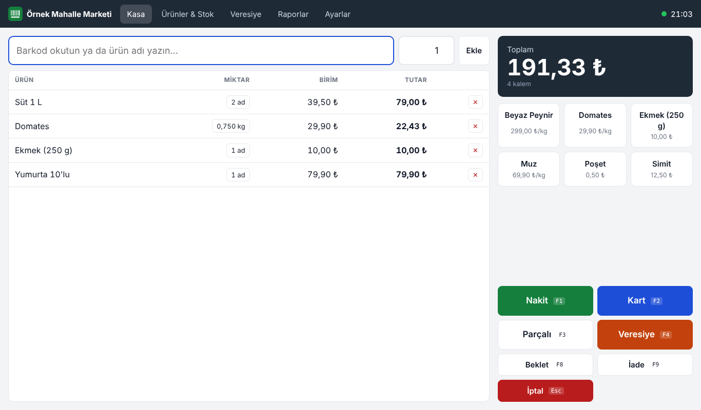
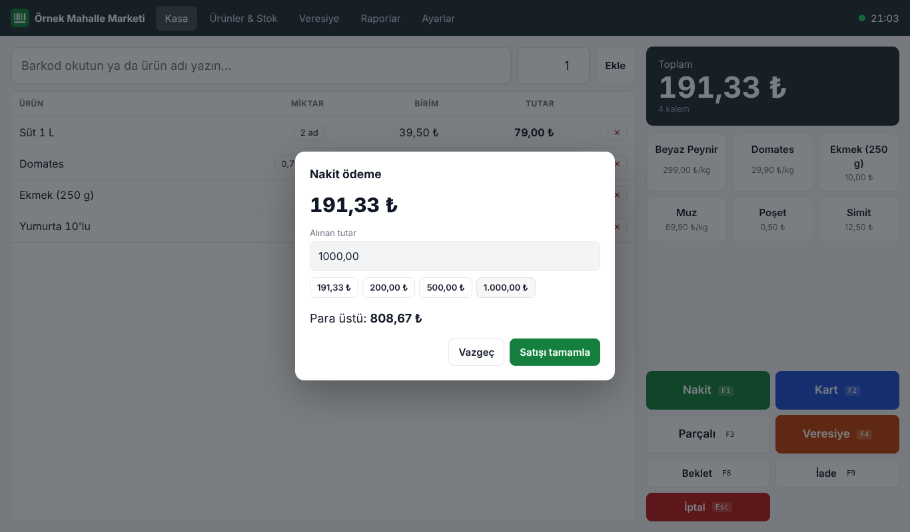
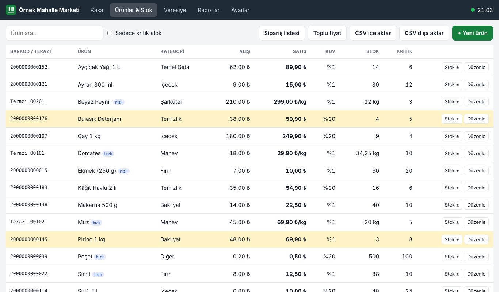
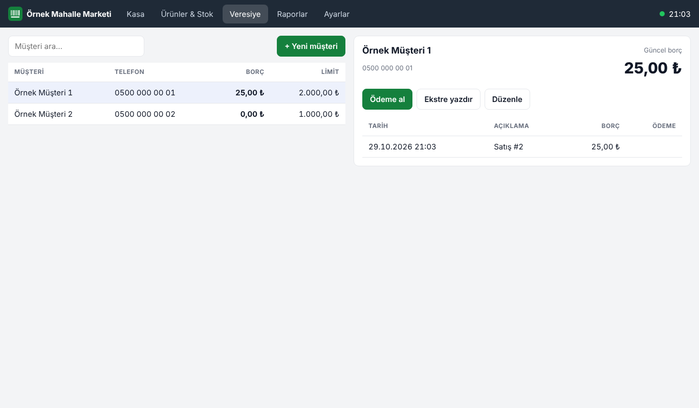
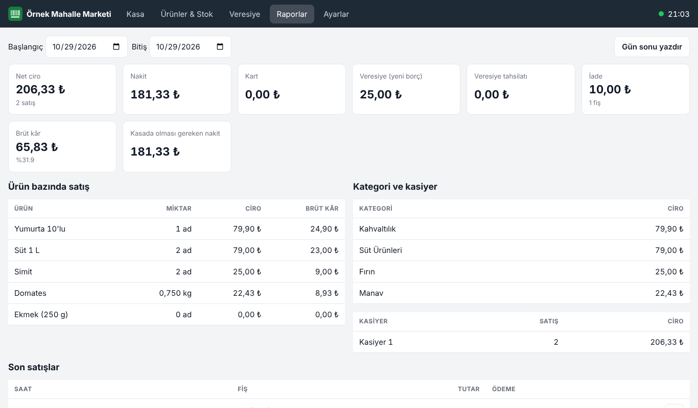
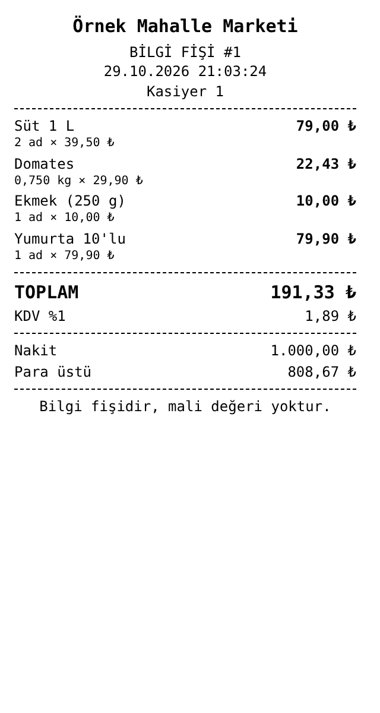

# market-pos

> Mahalle marketleri ve küçük bakkallar için barkodlu satış ekranı (POS), stok, veresiye ve gün sonu raporu. Tarayıcıda çalışır, kurulum gerektirmez, internet kesilse de satışa devam eder.

  

**Canlı demo:** https://harunnkcnn.github.io/market-pos/ *(GitHub Pages açıldıktan sonra)*

Bu proje [Harun Kaçan](https://github.com/harunnkcnn) tarafından geliştirilen açık kaynak bir **portfolyo / örnek projedir**. Demo verisindeki market, müşteriler ve barkodlar hayalîdir. Barkodlar mağaza içi kullanıma ayrılmış `200` ön ekiyle üretilir, gerçek ürünlerle çakışmaz.



---

## Sorun

Küçük marketlerde kasa genellikle ya pahalı ve karmaşık bir POS paketine ya da defter ve hesap makinesine bağlıdır:

- Barkod okutulsa bile stok ayrı bir yerde, elle düşülür.
- Veresiye defteri kasadan bağımsızdır, kimin ne kadar borcu olduğu ay sonunda netleşir.
- İnternet veya sunucu kesildiğinde kasa durur.
- "Bugün ne kadar sattık, kârımız ne?" sorusunun cevabı fişlerden çıkarılır.

**market-pos** bu dört sorunu tek ekranda ele alır.

## Özellikler (v0.1)

### Kasa
- USB/Bluetooth barkod okuyucu desteği. Okuyucu klavye gibi çalıştığı için ek sürücü gerekmez.
- Ürün adıyla arama ve barkodsuz ürünler için hızlı tuşlar (ekmek, poşet, manav)
- Tartılı ürün: kg girişi veya terazi barkodu (`27/28/29` + 5 hane ürün kodu + 5 hane gram)
- Nakit (hızlı para tuşları ve para üstü), kart, parçalı ödeme ve veresiye
- Satışı beklemeye alma, sıradaki müşteriye geçme
- İade modu: ürün stoka geri girer, iade fişi kesilir.
- Bilinmeyen barkod okutulunca "ürün ekle" penceresi açılır.
- 80 mm termal yazıcı için bilgi fişi (tarayıcıdan yazdırılır)
- Klavye kısayolları: `F1` nakit · `F2` kart · `F3` parçalı · `F4` veresiye · `F8` beklet · `F9` iade · `Esc` iptal

### Ürünler ve stok
- Satışta otomatik stok düşümü, kritik stok uyarısı ve vurgusu
- Mal girişi, fire ve sayım hareketleri
- Sipariş listesi (önerilen miktar = kritik × 2 − stok), yazdırılabilir
- Kategori bazında toplu fiyat güncelleme (yüzde veya tutar, 0,50 ₺'ye yuvarlama)
- `;` ayraçlı CSV içe ve dışa aktarma (Türkçe Excel ile uyumlu)

### Veresiye
- Müşteri kartı, borç limiti, limit aşımında uyarı
- Tahsilat (nakit/kart), hareket geçmişi, yazdırılabilir ekstre

### Raporlar
- Tarih aralığına göre net ciro, nakit, kart, veresiye, tahsilat, iade ve brüt kâr
- Kasada olması gereken nakit tutarı
- Ürün, kategori ve kasiyer bazında satış
- Gün sonu raporu yazdırma, son satışlardan fişi yeniden basma

### Veri ve çevrimdışı çalışma
- Tüm veriler cihazdaki **IndexedDB**'de saklanır, sunucu gerekmez.
- Service Worker sayesinde internet yokken de açılır (PWA, tablete "uygulama gibi" kurulabilir).
- JSON yedek alma ve yedekten geri yükleme

> **Not:** Bu uygulama yasal **ÖKC / yazar kasa** veya e-Arşiv / e-Fatura entegrasyonu yerine geçmez. Bastığı fiş bilgi fişidir. Mali fiş gereksinimleri için yetkili cihaz ve entegratör kullanılmalıdır.

## Ekran görüntüleri

| Kasa | Nakit ödeme |
|---|---|
|  |  |
| **Ürünler ve stok** | **Veresiye** |
|  |  |
| **Raporlar** | **Fiş (80 mm)** |
|  |  |

## Teknoloji

| Katman | Seçim | Neden |
|---|---|---|
| Arayüz | Saf HTML, CSS, JavaScript | Kurulum ve derleme yok, eski kasa bilgisayarında da çalışır |
| Veri | IndexedDB | Tarayıcıda kalıcı, internetsiz depolama |
| Çevrimdışı | Service Worker + Web App Manifest | Kasa internetsiz açılır |
| Para hesabı | Kuruş cinsinden tam sayı | Küsurat ve yuvarlama hatası olmaz |
| Test | `node:test` (Node.js 20+) | Ek bağımlılık gerektirmez |
| AI desteği | Claude | İskelet, test senaryoları, dokümantasyon |

## Kurulum

### En hızlı yol
Depoyu indirin ve `index.html` dosyasını Chrome ya da Edge ile açın. Demo verisi ilk açılışta otomatik yüklenir.

> Doğrudan dosyadan açıldığında çevrimdışı önbellek (Service Worker) devreye girmez. Tam PWA deneyimi için aşağıdaki yöntemlerden birini kullanın.

### Yerel sunucu ile
```bash
git clone https://github.com/harunnkcnn/market-pos.git
cd market-pos
npm start          # http://localhost:3000
# ya da: python -m http.server 3000
```

### GitHub Pages ile yayınlama
Repo **Settings → Pages → Source: Deploy from a branch → `main` / `(root)`** ayarıyla birkaç dakika içinde `https://<kullanıcı>.github.io/market-pos/` adresinde yayına girer.

### Testler
```bash
npm test
```

## Klasör yapısı

```
market-pos/
├─ index.html              # Tüm ekranlar (Kasa, Ürünler, Veresiye, Raporlar, Ayarlar)
├─ css/style.css           # Açık/koyu tema, dokunmatik uyumlu arayüz
├─ js/
│  ├─ para.js              # Kuruş tabanlı tutar hesapları, TL biçimlendirme, KDV payı
│  ├─ barkod.js            # EAN-8/13 doğrulama, terazi barkodu çözümleme
│  ├─ sepet.js             # Sepet ve ödeme kuralları (arayüzden bağımsız)
│  ├─ db.js                # IndexedDB deposu
│  ├─ demo.js              # Hayalî demo verisi
│  └─ app.js               # Arayüz ve olaylar
├─ sw.js                   # Çevrimdışı önbellek
├─ manifest.webmanifest
├─ assets/icon.svg
├─ tests/                  # para, barkod, sepet birim testleri
├─ docs/screenshots/
├─ package.json
└─ LICENSE
```

## Terazi barkodu

Varsayılan biçim `2X PPPPP WWWWW C` şeklindedir:

- `2X`: ön ek (27, 28 veya 29)
- `PPPPP`: terazideki ürün kodu (ürün kartındaki **Terazi kodu** alanı)
- `WWWWW`: gram cinsinden ağırlık
- `C`: EAN-13 kontrol hanesi

Örnek: `2700101007509` → terazi kodu `00101` (Domates), 0,750 kg.

## Yol haritası

- [x] v0.1: Kasa, stok, veresiye, raporlar, çevrimdışı çalışma, CSV, yedek
- [ ] v0.2: Kullanıcı girişi ve kasiyer yetkileri, ürün görselleri, raf etiketi yazdırma
- [ ] v0.3: Tedarikçi ve alış faturası, maliyet geçmişi
- [ ] v0.4: Çoklu kasa için isteğe bağlı sunucu eşitlemesi (Node.js + PostgreSQL)
- [ ] Sonrası: Terazi barkod biçimi ayarı, iskonto ve kampanya kuralları

## Katkı

Hata bildirimi ve önerileriniz için **Issues** bölümünü kullanabilirsiniz. Özellikle market ve bakkal işletenlerin sahadan geri bildirimleri çok değerli.

## Lisans

[MIT](LICENSE) © Harun Kaçan

---

**İletişim:** [GitHub](https://github.com/harunnkcnn) · [Behance](https://www.behance.net/harunkaan1) · [LinkedIn](https://www.linkedin.com/in/harun-ka%C3%A7an-58b423335/)
